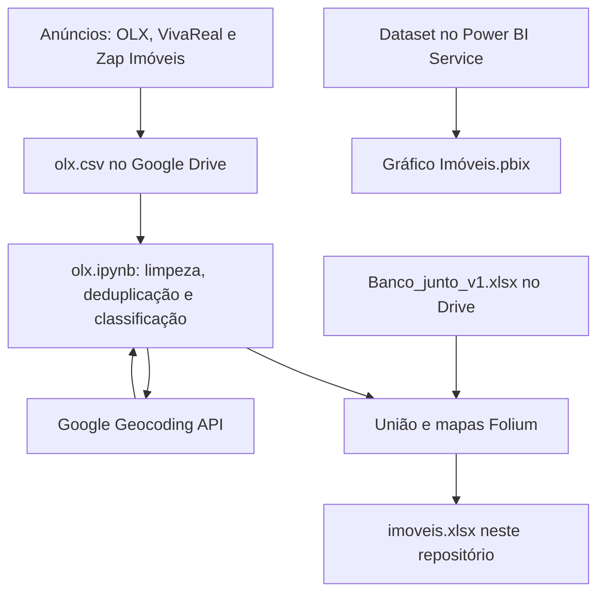

# Imóveis em Caruaru

Limpeza de anúncios de imóveis em Caruaru-PE e painel no Power BI, a partir de OLX, VivaReal e Zap Imóveis.

## Contexto

O projeto organiza anúncios públicos de imóveis em Caruaru (Pernambuco) para comparar tipo, área, preço e localização. A base junta links da OLX, do VivaReal e do Zap Imóveis. O tratamento foi feito em um notebook do Google Colab. O recorte visual está no Power BI, no painel de janeiro de 2025.

## O que este repositório faz

O notebook `olx.ipynb`:

- Lê o CSV de anúncios em `/content/drive/MyDrive/olx.csv`. Esse arquivo fica no Google Drive e não está versionado aqui.
- Renomeia as colunas da exportação, descarta linhas sem preço, área ou descrição e remove duplicatas.
- Mantém registros com `valor_area` de até 5.000. A mensagem impressa nessa célula fala em 6.000, mas o filtro do código é `<= 5000`.
- Classifica `tipo_de_imovel` e `mercado_referencia` por palavras na URL do anúncio.
- Consulta a Geocoding API do Google para preencher CEP, bairro, rua, número, latitude e longitude. A chave é lida de `GOOGLE_MAPS_API_KEY`.
- Une o resultado com `Banco_junto_v1.xlsx` (também no Drive, fora deste repositório), comparando descrição da localização, latitude, longitude, área e preço.
- Gera `mapa_caruaru.html` (pontos) e `mapa_calor_caruaru.html` (calor) com Folium. Os HTML são salvos no Drive.

A planilha `imoveis.xlsx` é a tabela que acompanha o repositório: 2.235 linhas e 17 colunas (`tipo_de_imovel`, `tipo_de_anuncio`, `mercado_referencia`, `descricao_localizacao`, `cidade`, `cep`, `bairro`, `rua`, `numero`, `longitude`, `latitude`, `unidade_area`, `valor_area`, `quartos`, `banheiros`, `preco`, `url_do_item`). A cidade preenchida é Caruaru. As URLs apontam para `pe.olx.com.br`, `www.vivareal.com.br` e `www.zapimoveis.com.br`.

O arquivo `Gráfico Imóveis.pbix` é um relatório do Power BI ligado a um dataset publicado no Power BI Service. A página se chama "DASHBOARD - IMÓVEIS CARUARU" e traz mapa, barras por bairro, colunas por tipo de anúncio, pizza de tipo de imóvel, barras por mercado e rosca de origem dos anúncios. O próprio relatório cita OLX, Zap Imóveis e VivaReal como fonte e marca o período de janeiro de 2025. A coluna `origem`, usada na rosca, não existe em `imoveis.xlsx`.

## Stack

- Python 3, pandas, requests, Folium, PrettyTable e openpyxl
- Google Maps Geocoding API
- Google Colab e Google Drive, nos caminhos do notebook
- Microsoft Power BI e Excel

## Fluxo



A planilha e o relatório cobrem o mesmo tema. O `.pbix` não importa `imoveis.xlsx`: a conexão do arquivo aponta para um dataset já publicado no serviço.

## Como executar

O notebook foi escrito para o Google Colab. Os caminhos `/content/drive/MyDrive/...` só existem nesse ambiente, e os CSV de entrada não estão neste repositório.

Dependências diretas, para inspecionar a planilha na sua máquina:

```bash
python -m venv .venv
source .venv/bin/activate
pip install -r requirements.txt
python -c "import pandas as pd; df = pd.read_excel('imoveis.xlsx'); print(df.shape); print(list(df.columns))"
```

Para a geocodificação, copie o exemplo de ambiente e preencha a chave só na sua máquina:

```bash
cp .env.example .env
```

```text
GOOGLE_MAPS_API_KEY
```

No Colab, defina essa variável no ambiente da sessão antes da célula de geocodificação. Use os segredos do Colab ou `os.environ` no runtime. Não cole a chave em uma célula do notebook.

O Power BI Desktop abre `Gráfico Imóveis.pbix`. Como o relatório está ligado a um dataset na nuvem, os visuais pedem login na conta que publicou esse dataset.

## Estrutura

```text
.
├── olx.ipynb                 # limpeza, classificação, geocodificação e mapas
├── imoveis.xlsx              # tabela consolidada de anúncios
├── Gráfico Imóveis.pbix      # relatório do Power BI
├── requirements.txt
├── .env.example
└── .gitignore
```

## Próximos passos

- Parametrizar os caminhos do Drive para o notebook rodar fora do Colab, com o CSV de entrada ao lado do código.
- Revisar preços fora de escala em `imoveis.xlsx` e alinhar a mensagem do filtro de área com o corte de 5.000.
- Completar `tipo_de_imovel` e `mercado_referencia` nas linhas em que a classificação pela URL ficou vazia.
- Documentar de onde sai a coluna `origem` usada na rosca do Power BI.
- Versionar os HTML dos mapas se eles forem parte do portfólio.
